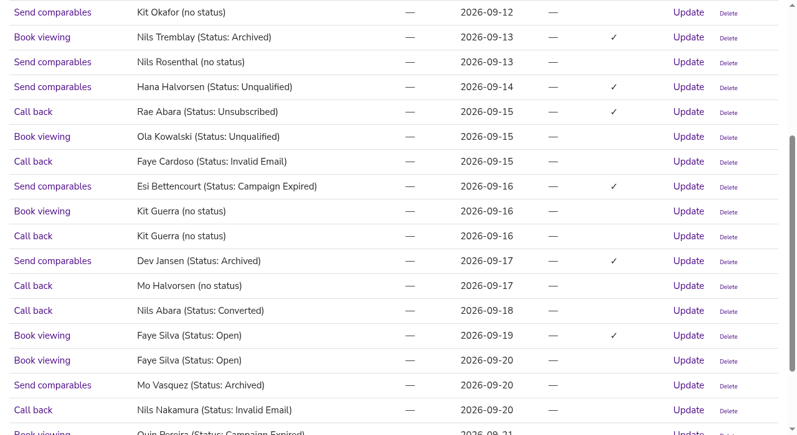
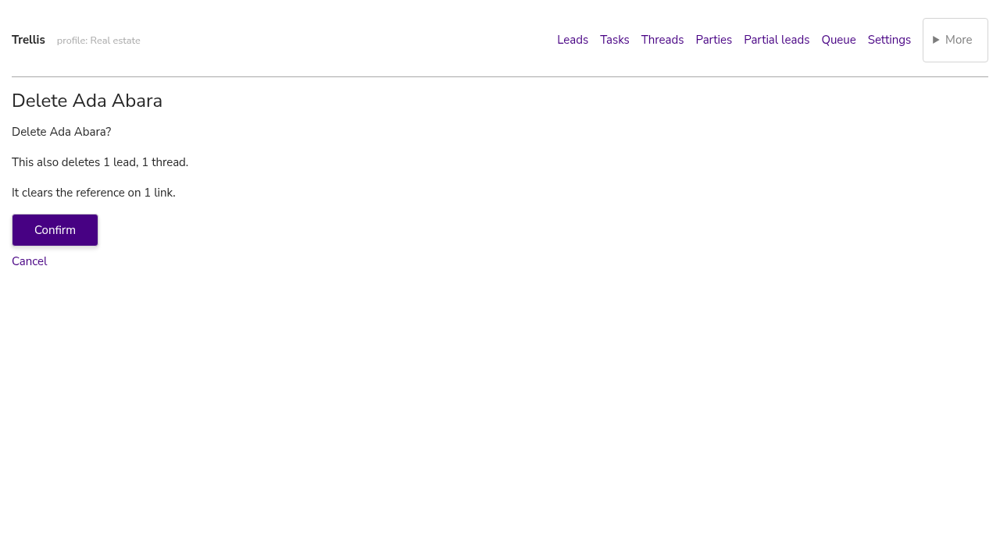
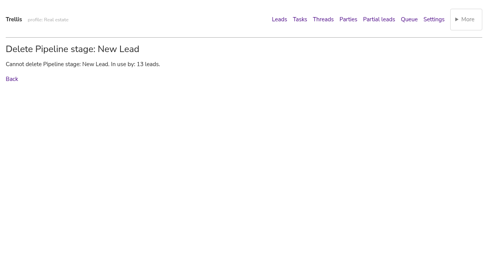
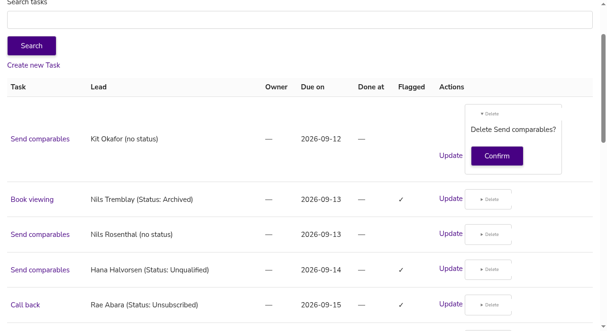
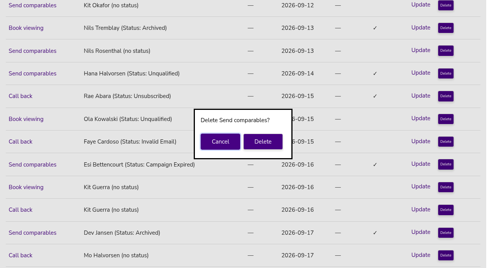

# Django Startr Code

Django Startr is here to turbocharge your project setup! With just a few commands, it auto-generates everything you need. Django Startr is a powerful tool that eliminates boilerplate code by automatically generating complete CRUD functionality for your Django models. With a single command, it creates:

- Class-based views (List, Detail, Create, Update, Delete)
- Forms for your models
- URL configurations
- Admin interfaces
- Templates with a clean, customizable design

## ⚡ Quick Start

### Installation

Choose one of these installation methods:

```bash
# Using pip
pip install django-startr

# Using git submodule (recommended for customization)
git submodule add https://github.com/Startr/STARTR-django-code.git our_submodules/STARTR-django-code
ln -s our_submodules/STARTR-django-code/django_startr django_startr
```

Add to your `settings.py`:

```python
INSTALLED_APPS = [
    # ...
    'django_startr',
    # ...
]
```

The Django admin skin is a second app with its own place in the list. See [The admin skin](#the-admin-skin).

### Basic Usage

1. Create your Django app and define your models:

```bash
python manage.py startapp store
```

2. Define your models in `store/models.py`:

```python
from django.db import models

class Product(models.Model):
    name = models.CharField(max_length=100)
    price = models.DecimalField(max_digits=10, decimal_places=2)
    description = models.TextField(blank=True)
    
    def __str__(self):
        return self.name
```

3. Run migrations:

```bash
python manage.py makemigrations
python manage.py migrate
```

4. Generate CRUD functionality:

```bash
python manage.py startr store
```

5. Add to your project's `urls.py`:

```python
from django.urls import path, include

urlpatterns = [
    # ...
    path('store/', include('store.urls')),
    # ...
]
```

That's it! You now have a fully functional admin interface and CRUD views for your models!

## 🔍 Detailed Usage

### Selective Generation

You can specify which models to generate for:

```bash
# Generate for specific models only
python manage.py startr store:Product,Category

# Generate for multiple apps
python manage.py startr store:Product inventory:Item,Warehouse
```

### URL Structure

Django Startr creates intuitive URL patterns:

```
# List view
/store/product/
# Detail view
/store/product/1/
# Create view
/store/product/create/
# Update view
/store/product/1/update/
# Delete view
/store/product/1/delete/
```

For shorter URLs, you can import specific URL modules:

```python
# In your project's urls.py
path('products/', include('store.urls.product_urls')),
```

This gives you cleaner URLs like `/products/` instead of `/store/product/`.

## 🛠️ Customization

### Views

Django Startr creates views in a `views` directory, with a separate file for each model:

```
store/
├── views/
│   ├── __init__.py
│   ├── product_views.py
│   └── category_views.py
```

Each view file contains class-based views with all common methods stubbed out for easy overriding:

```python
# Example of a generated ProductListView
class ProductListView(ListView):
    model = Product
    template_name = "store/product_list.html"
    paginate_by = 20
    context_object_name = "product_list"
    
    def get_queryset(self):
        # Override this method to customize your queryset
        return super().get_queryset()
        
    def get_context_data(self, **kwargs):
        # Override this method to add extra context
        return super().get_context_data(**kwargs)
```

### Templates

Generated templates extend a model-specific base template, which in turn extends your project's `base.html`:

```
templates/
├── base.html                  # Your project's base template
└── store/
    ├── product_base.html      # Base template for product
    ├── product_list.html
    ├── product_detail.html
    ├── product_form.html
    └── product_confirm_delete.html
```

This hierarchical approach makes it easy to customize templates at different levels.

### Admin Interface

Django Startr creates an intelligent ModelAdmin for each model with:

- Sensible defaults for `list_display` based on your model fields
- Smart `list_filter` setup for appropriate field types
- Automatic `search_fields` for text fields
- Performance optimizations with `list_select_related`

Example generated admin:

```python
@admin.register(Product)
class ProductAdmin(admin.ModelAdmin):
    list_display = ('name', 'price', 'description')
    search_fields = ('name', 'description')
    list_filter = ('price',)
```

The admin is named "Startr Admin" in its header and browser title. Set `STARTR_ADMIN_TITLE` in settings to use another name. A project that names its own admin keeps that name, whether it sets `admin.site.site_header` or uses an `AdminSite` subclass.

### The admin skin

The skin restyles the admin from startr.style's tokens and replaces Django's sidebar with the apps and models as tiers in the header. It lives in its own app, `django_startr.admin_skin`, because it must sit in a different place in `INSTALLED_APPS` than the rest of the package. Django serves a template from the first app that has it.

```python
INSTALLED_APPS = [
    "django_startr.admin_skin",   # before the admin: its admin/base_site.html and admin/login.html must win
    "django.contrib.admin",
    # ...
    "django_startr",              # after it: its base.html and registration/*.html must not shadow the admin's own
]
```

Put `django_startr` ahead of the admin and Log out answers 500, because the package's generic `registration/logged_out.html` reverses a `login` route most projects lack.

Django's sidebar goes only when the skin's `admin/base_site.html` is the one served. If your project overrides that template, or lists the skin after the admin, the sidebar stays and `manage.py check` says so (`startr.W001`). It also warns when the template engine lacks `django.template.context_processors.request` (`startr.W002`), since the tiers could not mark the current page.

| Setting | Meaning |
| --- | --- |
| `STARTR_ADMIN_TITLE` | The admin's name. Default "Startr Admin". |
| `STARTR_ADMIN_NAV` | Default `True`. `False` keeps Django's sidebar and breadcrumbs and draws no tiers. A custom `AdminSite` gets tiers by setting `enable_nav_sidebar = False`. |
| `STARTR_ADMIN_SMART_SELECT` | Default `False`. `True` turns every single `<select>` in the admin into a type-to-filter box. |
| `STARTR_STYLE_URL` | The kit's stylesheet: a full URL, or a static path for a vendored copy. |

The skin owns the theme. Django's own dark mode and theme toggle are left out, so the admin follows the project's kit theme: light unless the page sets `data-theme="dark"`.

## 🧭 Nav, columns and read-only models

### The nav

A generated list page is reachable only if something links to it. Mounting a urls module and linking to it are two acts, and the link is the one that gets forgotten: a page answers 200 and no shell points at it. The nav removes that act. Mount a model and its list page appears; unmount it and the entry goes.

Wire it as a context processor on the backend that renders your shell. Django's Jinja2 backend runs context processors, but only the ones named in `OPTIONS`.

```python
TEMPLATES = [{
    "BACKEND": "django.template.backends.jinja2.Jinja2",
    "OPTIONS": {
        "environment": "django_startr.jinja2env.environment",
        "context_processors": ["django_startr.nav.startr_nav"],
    },
}]
```

The ready-made navs, `startr_nav_html("dock")` and `startr_nav_html("tiers")`, render through a template engine the package owns. A Jinja-only project, with or without the admin, needs no DjangoTemplates backend for them.

The shell loops over `startr_nav` and reads `url` and `label` off each item.

```jinja

<a href="{{ item.url }}">{{ item.label }}</a>

```

An entry shows only where the viewer can use it. An authenticated user needs `<app_label>.view_<model>`. An anonymous viewer sees every model entry, because a generated list view is unauthenticated out of the box; a project that puts its lists behind login sets `STARTR_NAV_ANON = False`.

Each item also carries a `primary` flag, so the shell puts the few pages people use inline and folds the rest into a disclosure. `STARTR_NAV_PRIMARY` decides when set. Otherwise, if `STARTR_NAV_ORDER` is set, the entries it names plus every extra are primary. Otherwise everything is primary. A page named in `STARTR_NAV_DOCK` is primary whatever those lists say, so it always has a link.

All settings are optional.

| Setting | Meaning |
| --- | --- |
| `STARTR_NAV_ORDER` | Slugs or route names to put first, in this order. The rest follow alphabetically by label. |
| `STARTR_NAV_HIDE` | Slugs or route names never shown, whatever the permissions say. |
| `STARTR_NAV_LABEL` | `{slug or route name: label}`, overriding the derived label. Key it by route name when two apps share a model name. |
| `STARTR_NAV_EXTRA` | `[(route_name, label[, requirement]), ...]` for the hand-written pages a resolver walk cannot recognise. The requirement is a permission string, or `is_authenticated` / `is_staff` / `is_superuser`. |
| `STARTR_NAV_ANON` | Default `True`. `False` drops the anonymous pass. |
| `STARTR_NAV_PRIMARY` | Slugs or route names that belong in the main nav. |

Two apps with a model of the same name produce two identical labels. Colliding labels get their app's name in front, unless a project set the label by hand in `STARTR_NAV_LABEL`.

### List columns

A row that renders the bare object is only as legible as the model's `__str__`. Widening `__str__` to fix that is the wrong move: the same string is what every ForeignKey dropdown, the admin changelist and every log line show. The list page gets a table instead, its columns guessed from the model.

There is nothing to switch on. The generator ranks each field by how much it tells you about the row — a foreign key first, then a choice, then a date, then a boolean, then the rest — and keeps the top four. Prose, blobs and structures (text, JSON, binary, file) are left out.

The columns are written into the template literally, so a wrong guess costs one edit in one file, and since an existing file is never overwritten that edit survives every later run.

```
<tr>
  <td><a href="{{ url('store:product_detail', product.pk) }}">{{ product }}</a></td>
  <td>{{ product.name }}</td>
  <td>{{ product.price }}</td>
</tr>
```

### Read-only models

Some models append and are never edited or deleted. Generating a CreateView for one writes a form that saves, appends the row, and lies about what happened. A read-only model gets list and detail pages and nothing else.

Say so on the model. `Startr` sits next to the fields it describes, so it is the form to prefer.

```python
class AuditEvent(models.Model):
    action = models.CharField(max_length=100)
    created = models.DateTimeField(auto_now_add=True)

    class Startr:
        readonly = True
```

Two other ways: a base class named `AppendOnlyModel`, or the model listed as `"app_label.ModelName"` in `settings.STARTR_READONLY_MODELS`.

## 🗑️ Deleting

A row with a one-click Delete on it deletes on one click. That was the old list page and the old detail page alike, and it was wrong: a misread row and a stray click destroyed a record and everything under it, with no second look and no way back.

The generator has always written a `<model>_delete.html`, and nothing could reach it. Both pages posted straight at the delete route, and the generated `DeleteView` raised `Http404` on GET — so the confirm page 404ed even if you typed its URL. Deleting now means reaching that page, or one of two other second steps, chosen by settings.

All three modes end in a POST. None of them deletes on a GET, so a prefetch, a crawler or a back button cannot remove a row. Two of the three need no JavaScript. Only dialog mode does, and with JavaScript off its form still posts — there is just no confirmation in front of it.

### The second step

The delete control is one partial, shared by the list, detail and update pages, so the three cannot drift apart. It renders one of three shapes, and each shape ends in a POST to the model's delete route.

The mode is a project-wide setting, not a per-model one. `STARTR_DELETE_CONFIRM` picks the shape; the default is `page`.

### The three modes

| Mode | What it does | Needs JS |
| --- | --- | --- |
| `page` | A link to the model's delete page, which carries the Confirm form. The default. | No |
| `inline` | A `<details>` that opens the real form in place, so a long list does not lose your position. | No |
| `dialog` | A real `<dialog>`, opened by django_startr's own static file. | Yes |

The small control in a list row:



The confirm page names the cascade before it happens:



A row another table protects, so no Confirm button is offered:



The in-place reveal, opened:



The modal, open:



### What the confirm page says

"Are you sure?" names nothing, so people click through it. Django's collector already knows exactly what a delete takes with it, because it is the same collector that runs a moment later. The confirm page says it before you commit:

- **What it also deletes.** The cascades: `This also deletes 1 lead, 3 threads.`
- **What it clears.** The rows whose reference is set to null rather than deleted: `It clears the reference on 2 actions.`
- **What it cannot do.** A `PROTECT` foreign key refuses the delete outright. That used to be a 500 — the page offered a button the database would reject. Now it is a sentence and no Confirm button.

The names come from the model's verbose names. Two apps with a model of the same name get their app name in front, so `1 link` and `1 link` never both appear.

The blocked check runs twice on purpose. The template hides the Confirm button, and `post` checks again — a hidden button is a courtesy, not a guard, and the URL is still there to be typed.

### Settings

| Setting | Meaning |
| --- | --- |
| `STARTR_DELETE_CONFIRM` | Which second step the delete controls get: `page` (a link to the delete page), `inline` (a `<details>` opening the form in place), or `dialog` (a `<dialog>` opened by JavaScript). Default `page`. An unknown value raises rather than falling through to a mode nobody chose. |
| `STARTR_DELETE_BUTTON_STYLE` | `startr.style` inline props for the control. Default `'--size: 0.6rem; --p: 0.4rem; --ml: 1rem;'`. |

All settings are optional.

## 📋 Best Practices

### Project Structure

For large projects, consider organizing your code as follows:

```
myproject/
├── apps/                      # Your Django apps
│   ├── store/
│   └── inventory/
├── our_submodules/            # Git submodules
│   └── STARTR-django-code/
├── django_startr -> our_submodules/STARTR-django-code/django_startr
├── templates/                 # Project-wide templates
│   └── base.html
└── manage.py
```

### Customization Flow

1. Generate the initial code
2. Customize views for specific business logic
3. Enhance templates with your design
4. Extend the admin interface for advanced features

### Regeneration

When adding new models, you can safely regenerate code:

1. Back up any customized files
2. Run `python manage.py startr your_app:NewModel`
3. Merge your customizations back in

## 🚀 Planned Features

1. **Change Detection**: Automatically detect model changes and update generated code while preserving customizations
2. **Test Generation**: Create basic unit and integration tests for models and views
3. **API Integration**: Generate Django REST Framework serializers and viewsets
4. **Documentation**: Generate Swagger/OpenAPI documentation for your models
5. **Form Enhancement**: Add support for crispy-forms and more advanced form layouts
6. **Theming System**: Provide multiple template themes with easy switching
7. **Admin Customization**: More advanced admin features like filters, actions, and inline forms
8. **Internationalization**: Better i18n support in generated templates

## 🤝 Contributing

Contributions are welcome! Here's how you can help:

1. Fork the repository
2. Create a feature branch: `git checkout -b new-feature`
3. Commit your changes: `git commit -am 'Add new feature'`
4. Push to the branch: `git push origin new-feature`
5. Submit a pull request

## 📜 License

Copyright 2023-2025 12787326 Canada Inc.

Django Startr is dual-licensed:
- Pre-2023 code: MIT License
- Post-2023 code: AGPLv3

See [LICENSE.md](LICENSE.md) for full details.

